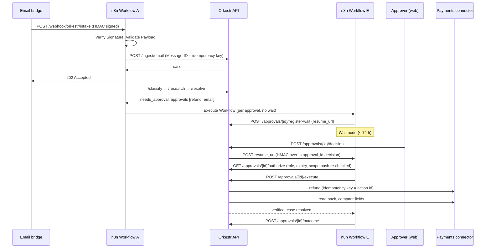
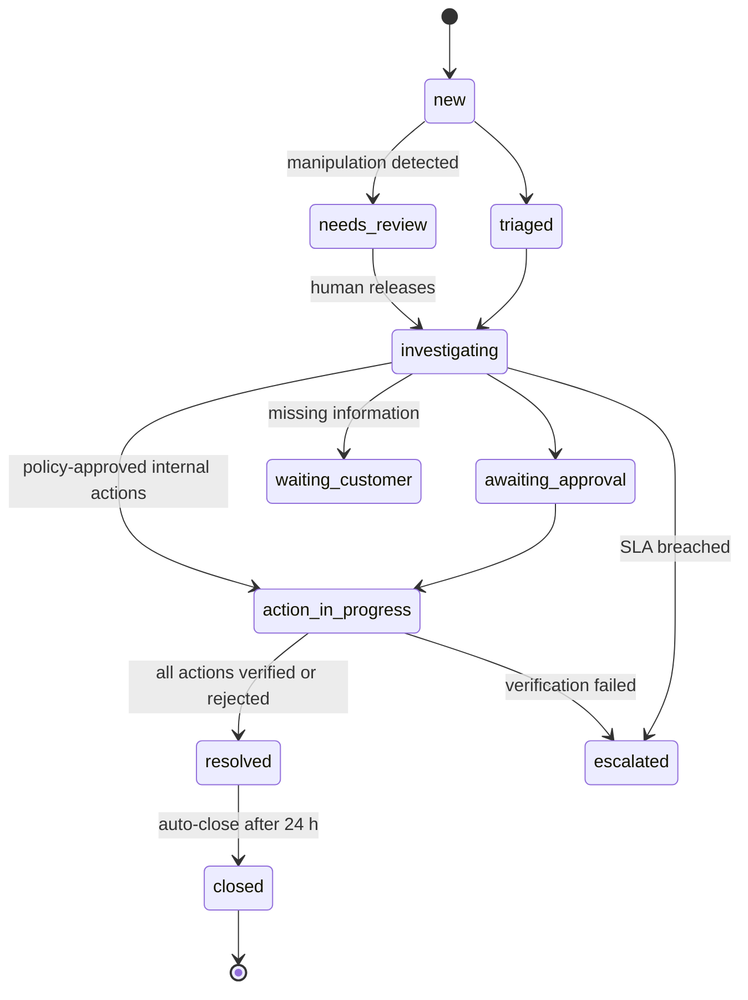

# Architecture

## Responsibilities

| Layer | Owns | Never does |
|---|---|---|
| **n8n** | When things happen: webhook intake, ordering of stages, retries with back-off, waiting for humans (Wait node), schedules, error workflow, fan-out to sub-workflows | Holds business state, decides policy, talks to Jira/Slack directly |
| **Orkestr API** | What is true: cases, approvals, RFPs, requirements, proposals, audit, idempotency, policy, connectors, agents | Long waits or schedules (it hands those to n8n) |
| **Agent runtime** | Bounded, observable model/tool use inside an API request | Executes consequential actions without an approval whose scope hash matches |
| **Web app** | Human decisions and inspection | Talks to n8n directly |

This split is the core design decision ([ADR 0002](adr/0002-n8n-orchestrates-api-owns-state.md)). Because every stage endpoint is idempotent and the API is authoritative, an n8n retry, a duplicated webhook or a replayed dead letter converges on the same state.

## Module map (modular monolith)

```
app/platform     identity & RBAC (deps.py), approvals, audit chain, idempotency, workflows (n8n client, run/step ledger),
                 knowledge (chunking, embeddings, hybrid search), notifications
app/ops          state_machine, triage rules, agents (triage, research, resolution graph, communication, executor, verifier), service
app/rfp          extraction, requirements, compliance, proposal, export, service
app/agents       runtime (budgets, tool registry, checkpoints, cancellation), providers, tools
app/integrations connectors: simulators + live adapters behind one interface
app/routers      HTTP layer only; maps domain errors to retry semantics (503 = transient → n8n retries; 4xx = permanent)
```

`ops` and `rfp` share platform services (approvals, audit, agents, workflows) but do not import each other ([ADR 0001](adr/0001-modular-monolith.md)).

## Request flow: customer refund



## Case state machine



Transitions are enforced in `ops/state_machine.py`; every change is a `case_event` and an audit record.

## Data model highlights

- `workflow_runs` / `workflow_steps`: one run per n8n execution id; one step per API call or reported node, with attempt numbers (retries) and durations.
- `approvals.scope_hash`: SHA-256 of action type + canonical parameters; `resume_url` of the waiting n8n execution.
- `audit_events`: `seq`, `prev_hash`, `hash` per workspace; appends are serialised with a transaction-scoped advisory lock.
- `inbound_events`: unique `(workspace_id, idempotency_key)`; the database constraint is the arbiter under concurrency.
- `knowledge_chunks.embedding vector(384)` with an HNSW index, plus a GIN index on `to_tsvector('english', text)`.
- `requirements.char_start/char_end`: offsets into the extracted page text so the UI can highlight the exact source.
- `agent_runs` / `tool_calls`: written through an autonomous session ([ADR 0007](adr/0007-autonomous-agent-telemetry.md)).

## Hybrid retrieval

1. Lexical: OR-query of non-stopword terms against the GIN index, ranked with `ts_rank_cd`.
2. Semantic: cosine distance on pgvector with the query embedding.
3. Reciprocal rank fusion (k = 60) over the top 4k of each list; filters for workspace, `approved`, and `valid_until > now()` (expired certificates are never retrieved).

## Compliance assessment

For each requirement: retrieve evidence; compute key-term coverage per passage; run specific checks — named certificates must appear in a valid *certification* document, numeric thresholds (e.g. availability %) must be met by the evidence value, and an approved standard response that negates the requirement *in the same clause* yields non-compliant. Procedural requirements (submission, deadline, evaluation, attachments) are marked for the bid manager instead of being matched against product evidence. A requirement can only be compliant with evidence attached; the API also rejects a human setting compliant without evidence.

## Observability

- Structured JSON logs with correlation ids (`X-Correlation-Id` propagated from n8n).
- Prometheus metrics at `/metrics`: HTTP, workflow steps, agent runs and latency, tool calls, LLM tokens, approvals, duplicates, integration calls.
- OpenTelemetry tracing of FastAPI (OTLP/HTTP export when `ORKESTR_OTEL_ENABLED=true`).
- `/analytics/overview` derives business metrics from stored events: workflow success and latency, case resolution time, SLA compliance, RFP processing time, evidence coverage, tool failure rate, model usage and estimated cost, approval turnaround, latest evaluation results.
